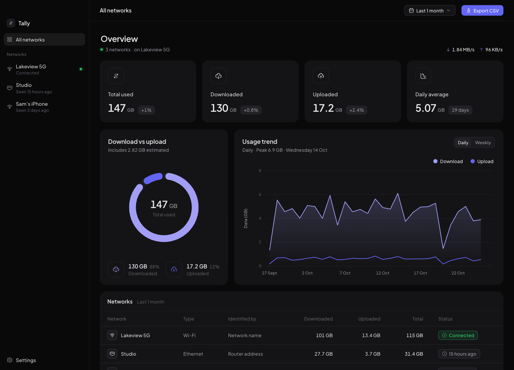

# Overlook: per-network data usage for macOS, Windows and Linux

Overlook records how much data you use on each network. It keeps a separate history for each network and shows interactive charts for ranges from 24 hours to 1 year. It runs from the menu bar / system tray, and everything stays on your computer.



## Build & run
Prerequisites: Rust (`rustup`), Node 20+. On Linux, also install the [Tauri system packages](https://tauri.app/start/prerequisites/) (webkit2gtk, libayatana-appindicator).

```sh
npm install
npm run tauri dev                     # development
npm run tauri build                   # release bundles: .app/.dmg, .msi/.exe, .deb/.rpm/.AppImage
cargo test -p overlook-core              # collector, attribution, storage (24 tests)
npm test                              # ranges, buckets, statistics (12 tests)
```

Build each OS's installer on that OS (or in CI with a matrix). The core crate type-checks for all three targets from any host:
`cargo check -p overlook-core --no-default-features --target x86_64-pc-windows-msvc`.

Visual QA without Tauri: run `npm run dev` and open `http://localhost:1420/?platform=windows&access=denied` (or `#tray`). In that mode a dev-only mock (`src/dev/mock.ts`) supplies synthetic history; it is never included in a build.

## Architecture
```
crates/overlook-core   Rust, no UI. Unit-tested.
  system.rs         per-OS counters, boot time, physical-adapter filter, router MAC, Wi-Fi names, permission
  processor.rs      pure delta + attribution logic (resets, gaps, switches)
  store.rs          SQLite (hourly buckets; same schema as earlier versions)
  lib.rs            Collector: fingerprint networks, sample, persist, live rate
src-tauri           shell: commands, 5 s collector thread, tray + popover, autostart, close-to-tray, migration
src                 React UI, custom components (no UI or chart library; Hugeicons for icons)
  lib/analytics.ts  ranges, calendar buckets, stats (runs in the UI so DST/week starts use the OS's rules)
  components/       Dashboard, UsageChart (SVG), Dialogs/Settings, ui primitives, Icon (Hugeicons)
  Tray.tsx          tray popover
```

## How it measures
| | macOS | Windows | Linux |
|---|---|---|---|
| Byte counters (64-bit) | `sysctl NET_RT_IFLIST2` | `GetIfEntry2` | `/sys/class/net/*/statistics` |
| Physical adapters | `en*` Wi-Fi/Ethernet | Wi-Fi/Ethernet minus Hyper-V/VPN/TAP/WSL/Bluetooth | Interfaces with a backing `device` |
| Router MAC | configd `ARPResolvedHardwareAddress` | IP Helper `SendARP` (via netdev) | netdev gateway, else `/proc/net/arp` |
| Wi-Fi name | CoreWLAN (needs Location) | `netsh wlan` (Win 11 needs Location) | `iw` or `nmcli` |
| Boot time | `kern.boottime` | `GetTickCount64` | `/proc/stat btime` |

- **Identity.** A network's key is `wifi:<SSID>` or `router:<MAC>`, never the adapter name alone. If a network later gains or loses its SSID, it keeps one history, matched by router MAC.
- **Sampling.** The collector checks network identity every 5 s and records a sample every 30 s, or immediately when the identity changes. That keeps any ambiguity around a network switch to a few seconds.
- **Resets.** After a reboot, or when counters go backwards, Overlook takes a new baseline and counts nothing for that interval.
- **Estimates.** Traffic during a network switch is counted but marked as estimated. So is traffic across a gap (sleep, or Overlook not running) when the network was the same at both ends. If the network changed during a gap, the bytes are recorded as *unattributed* and aren't counted toward any network.
- **Gaps.** A coverage table records when collection was running. Untracked periods render as no bar and no track, never as zero.
- **VPNs.** Tunnel and virtual adapters are excluded, so VPN traffic is counted once, on the physical adapter that carries it.

### Limitations
- Overlook only records while it's running. Counters restart at boot, so turn on *Open at login*; it then launches hidden in the tray.
- LAN traffic (casting, NAS backups) is counted, which may not match a data cap.
- There's no per-app breakdown.
- Two different networks with the same SSID share one history.
- Windows doesn't report whether Location access was granted, so if an SSID can't be read the network falls back to its router name.
- Linux SSIDs need `iw` or NetworkManager installed.
- **Verification:** the Windows and Linux paths compile and are covered by parser unit tests, but they haven't been run on those operating systems.

## Design
- **Dark mode** is its own palette, not an inversion:
  - Canvas `#09090B`, cards `#111113`, controls `#18181B`.
  - Borders are hairlines at 6.5% white.
  - Text uses three steps: `#EDEDEF`, `#9A9AA3`, `#5D5D66`.
- **App icon:** lavender/indigo binoculars on a near-black rounded square (`docs/app-icon.png`); the menu-bar/tray icon is a monochrome template version, and the sidebar logo uses Hugeicons' binoculars.
- **Typeface:** Plus Jakarta Sans (variable), bundled through Fontsource so it works offline and renders identically on every OS. Body text uses weight 450 with slightly opened tracking; numbers use tabular figures.
- **Palette:** lavender and indigo throughout. Download is lavender `#A29EF6` (dark) / `#9B98F3` (light), upload is indigo `#6366F1` / `#4F46E5`, and the accent is indigo. The pair passes colour-vision-deficiency and contrast checks in both modes; the dark lavender sits slightly above the recommended lightness band, which is deliberate for this look. Green, amber and red are reserved for status. The theme follows the system or a persisted System/Light/Dark choice, and the native title bar matches it.
- **Layout:** separate borderless cards (the surface sits on a darker canvas in dark mode, white on light grey in light mode) with 16 px gutters.
  - Page header: name, connection status, live rate.
  - Four stat cards (total, downloaded, uploaded, daily average), each with an icon tile, the value and a neutral change pill vs the previous period.
  - *Download vs upload* (a donut with rounded segments, the total in the centre, the estimated share noted, and icon-tiled figures below) beside *Usage trend* (overlaid lines, a gradient under the leading series, legend dots that toggle each series, a dashed hover guide with dots and a tooltip; untracked periods break the lines).
  - A table card with status pills: networks (Connected / last seen) in the All-networks view, or recent days (Measured / estimated / Not tracked) for one network.
  - Typical usage, Highlights and About-network cards.
  - Top bar: a range dropdown (⌘/Ctrl+1…7) and a primary **Export CSV** button that saves hourly rows to Downloads.
- **Components** are all custom: segmented control, toggle, dialogs, context menu, SVG charts and tooltip. Icons come from the free [Hugeicons](https://hugeicons.com) stroke set (`@hugeicons/react`), mapped to semantic names in `src/components/Icon.tsx`.
